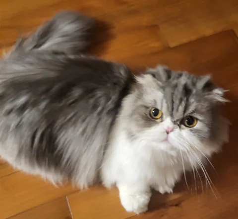
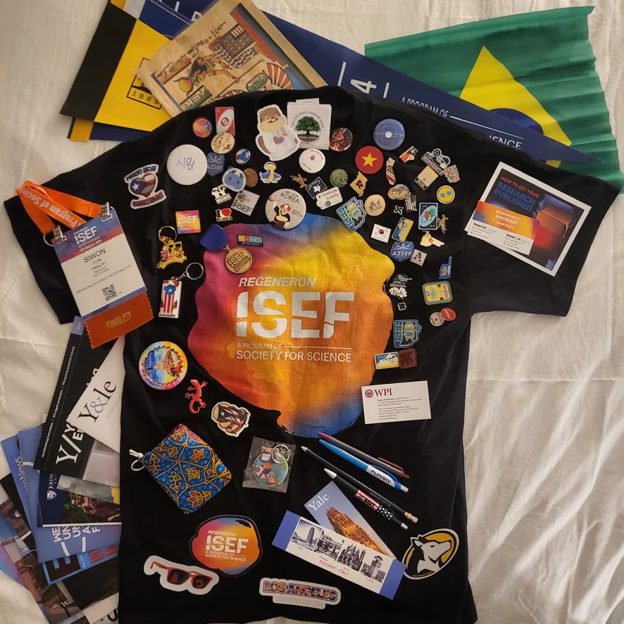
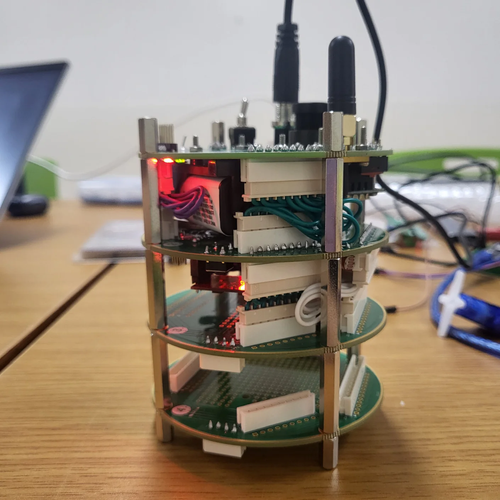

# Siwon Yun (윤시원, 尹時元)
> $$-\log \Pr(x)$$​

    <figure>
        
        <figcaption>my cat, Goorm</figcaption>
    </figure>

## Contact
**Email**: siwonyunkr[at]gmail[dot]com\\
**GitHub**: [siwonyun](https://github.com/siwonyun/)\\
**LinkedIn**: [i-love-you](https://www.linkedin.com/in/i-love-you/)

## Pages
- [CV](/cv/) ([PDF](/cv/siwon-yun-cv.pdf))
- [Education](/education/)
    - [Incheon National University](/education/bs/)
    - [Korea Digital Media High School](/education/dimigo/)
- [BCSC](/bcsc/), Brain and Cognitive Science Community
- [Photos](/photos/)

## Selected Honors & Awards
- [Regeneron International Science and Engineering Fair (ISEF)](https://www.societyforscience.org/isef/) 2024{::nomarkdown}<figure class="sn"><figcaption>ISEF</figcaption></figure>{:/} [[photos](/photos/#isef)]
    - Los Angeles, CA
    - Finalist, Society for Science [May 2024]
- BCSC 7th IDEA HACKATHON 2026
    - 1st Place [7–9 Aug 2026]
- 디미고 IT역량 UP 프로그램
    - GrandMaster — 2nd of 189 [2024]
- Korea Code Fair (KCF) 2023 [[photos](/photos/#kcf)]
    - Bronze Medal, Ministry of Science and ICT
- SmarTeen App+ Challenge (STA+C) 2023
    - Bronze Medal, SK Planet / Ministry of SMEs and Startups [Oct 2023]
- [E-icon World Contest](https://e-icon.or.kr/en/) 2022
    - Bronze Medal, Ministry of Education [2022]

## Experience
- [Brain and Cognitive Science Community (BCSC)](https://bcscommunity123.wixstudio.com/bcsc) [[page](/bcsc/)]
    - [Mar 2025 – Current]
    - Committee Member [Mar 2026 – Current]
- [GAI Lab](https://sites.google.com/view/gailab/)
    - Intern [Sep 2025 – Current]
- [Quantum Information Science Summer School](https://qschool.info) 2025
    - Quantum Information Research Support Center [11 Jan – 16 Jan 2025]
- [Counterspell: Seoul](https://counterspell-seoul.vercel.app) [[photos](/photos/#counterspell)]
    - Co-organizer, Hack Club [23 Nov – 24 Nov 2024]
- [CANSAT COMPETITION KOREA](https://cansat.kaist.ac.kr) 2023{::nomarkdown}<figure class="sn"><figcaption>cansat</figcaption></figure>{:/} [[photos](/photos/#cansat)]
    - First-round qualifier
- KAIST Creative and Global Leader Program (창의적 글로벌 리더 프로그램) 2023 Summer [[photos](/photos/#cgl)]
- Korean Scholars Conference for Youth (KSCY) 2023 [[photos](/photos/#kscy)]
    - Official Ambassadors, Computer Engineering Research Track
